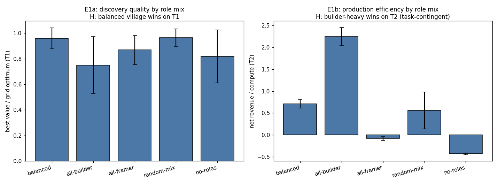
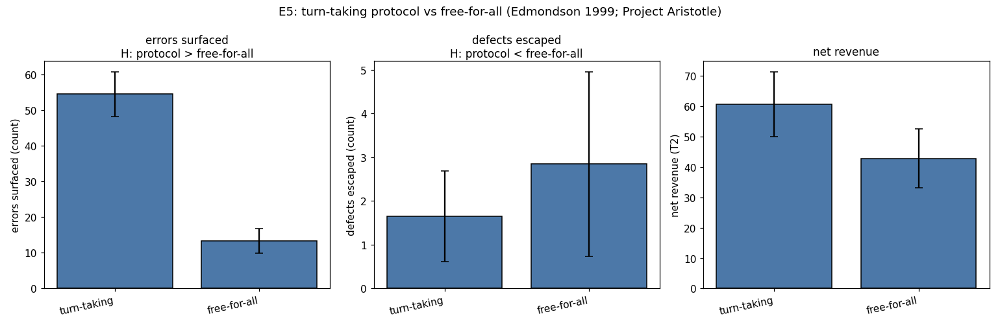
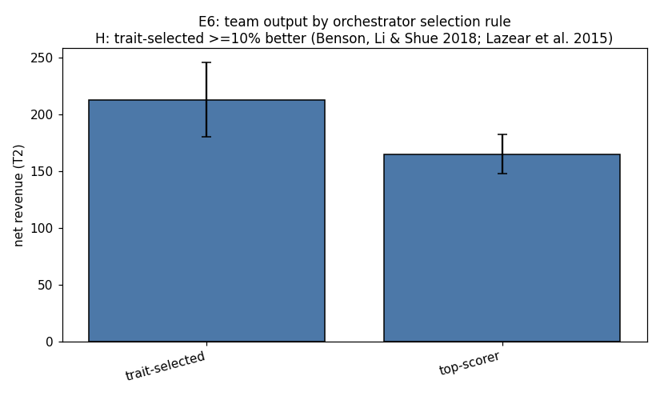
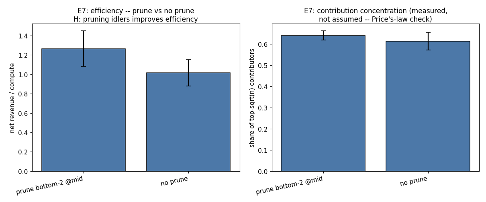
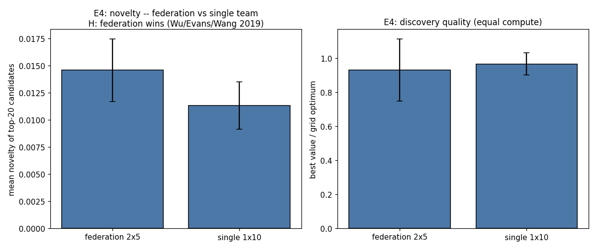
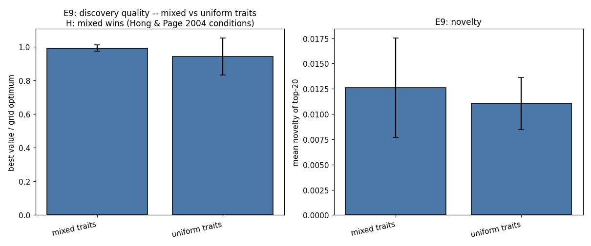
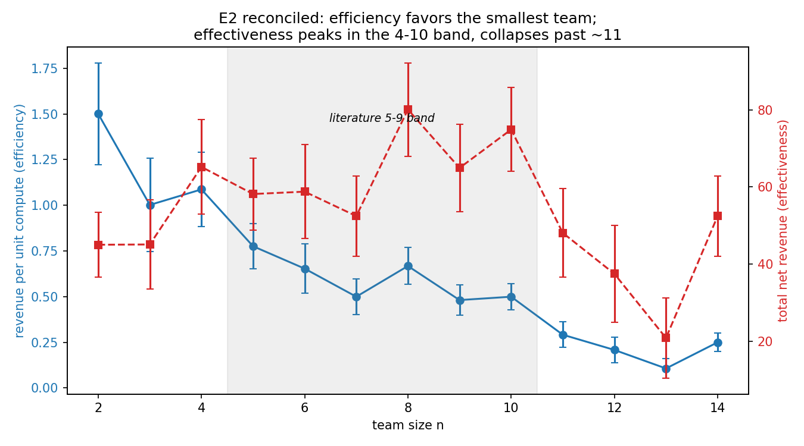
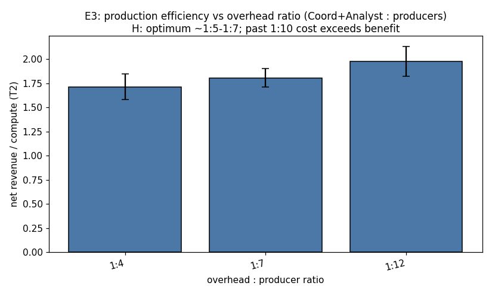
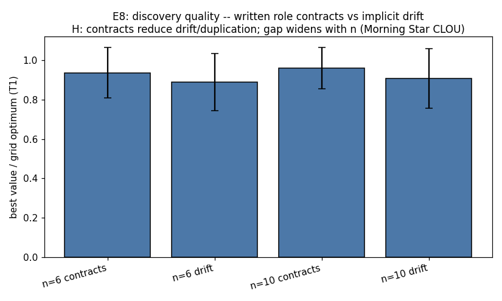

# Agent Forms: What 100 Years of Organizational Wisdom Says About Building AI Teams

*If a company is a super-organism — Google as a living being, a country as a single giant intelligence — then designing a multi-agent AI system is an organizational design problem. So we raided a century of management science, military doctrine, and anthropology, turned it into nine falsifiable experiments, and ran them. Here's what held, what broke, and the formula we're left with.*

---

## 1. The village intuition

The idea started with a village. Picture one: a few dozen people who need to survive and thrive. They don't all do the same job. There's someone good with tools, someone who sizes up problems before anyone lifts a finger, people who do the physical work, people who keep accounts and judge disputes, a healer, and someone who tells the story of the village to outsiders — part diplomat, part propagandist.

Now replace "people" with "agents" and the village with a company, and you get the central bet of this project:

> **An enterprise is a multi-agent system that evolution already debugged. The org chart is a discovered architecture. We should steal it.**

Companies figured out — through bankruptcy, war, and trial and error — things the AI agent literature is only now rediscovering: that adding members has diminishing returns (Brooks's law, 1975; Ringelmann, 1913), that the best individual contributor often makes the worst manager (Benson, Li & Shue, 2018, n=53,035), that small teams disrupt while large teams develop (Wu, Evans & Wang, 2019, n=65 *million* artifacts), and that flat organizations only survive by moving management somewhere else — into markets, contracts, or split rules (Haier's 4,000 microenterprises; Buurtzorg's 900 self-managing nursing teams; Morning Star's written CLOU commitments).

Meanwhile, the agent literature has its own converging evidence: diverse proposers beat more samples (Mixture-of-Agents: 65.1% vs GPT-4o's 57.5% on AlpacaEval), a lead agent with 3–5 subagents beats a single giant model by 90% on research tasks (Anthropic, at ~15× the token cost), and multi-agent setups *degrade* 39–70% on sequential tasks when coordination isn't designed (DeepMind–MIT scaling study). Notably: **no published work tests ideal role-mix percentages or management depth against outcomes.** That gap is this project's home turf.

So we did what the user's standing rule demands for every new arena: researched the past winners first — in this case, a century of winning organizations — then built something calibrated to land above the current caliber of discussion.

## 2. The village cell: six roles

We mapped the village archetypes onto agent roles (with Belbin's team-role clusters as the academic backbone):

| Village archetype | Agent role | Job in the swarm |
|---|---|---|
| Problem-sizers | **Framer** | Scopes the problem, proposes high-variance novel directions |
| Blue-collar | **Builder** | Does the core work, turns proposals into tested outputs |
| White-collar | **Analyst** | Evaluates, kills bad candidates, measures |
| Tradescraft experts | **Specialist** | Deep narrow skill; hill-climbs inside a subdomain |
| Healers | **Healer** | Repairs cohesion, surfaces errors and negative results, preserves dissent |
| Propagandists | **Herald** | External links: imports outside information, broadcasts the narrative |
| (village chief) | **Coordinator** | Allocates budget and attention, owns the mission |

The hypothesis: a balanced cell of 6–7 — one of each — beats homogeneous teams. But "beats at what?" We scored everything two ways: **discovery** (searching a rugged landscape full of local optima — the scientific-discovery analog) and **revenue** (a production pipeline with defects, quality multipliers, and demand — the money analog). And we instrumented the two failure modes explicitly: coordination overhead (too many cooks) and per-agent contribution concentration (the 80/20 idleness trap).

Each agent also gets a personality: four traits (diligence, creativity, sociability, conformity) initialized with role-typical means plus noise. Roles are behavioral priors, not straitjackets — and trait mix is itself an experimental variable.

## 3. The wind tunnel (read this before the results)

An honesty box, because it matters more than any single finding:

- **These are simulations, not LLM agents.** Agent behaviors are parametric policies; the tasks are stylized analogs. Think of it as a wind tunnel for org design: the cheapest possible place to be wrong.
- **Every parameter comes from the literature**, cited in the code — Ringelmann's loafing curve (effort falls 100% → 93% → 85% → 49% as groups grow 1 → 2 → 3 → 8), Graicunas's n(n−1)/2 coordination math, the Hong–Page diversity mechanism. Guesses are marked `ASSUMED`. Nothing was tuned to make a favored composition win.
- **Contradictions are findings.** Three of our nine hypotheses broke. They're reported below, not buried — they're the most interesting part.
- **20 seeds per condition**, error bars everywhere, sensitivity analyses on the load-bearing claims.

Code, data, and figures: this repo (`experiments/`). Reproduce everything in ~3 minutes with `python experiments/run_experiments.py`.

## 4. What held

### Balanced villages discover; builder monocultures produce (E1) 🟢

On the discovery landscape, the balanced 6-role cell scored **0.960 ± 0.083** (fraction of grid optimum) while the all-Builder team collapsed to **0.751** — correlated heuristics marching into the same local optimum, the Hong–Page mechanism working exactly as modeled. But flip to the revenue pipeline and the all-Builder team wins **2.249 vs 0.711** — a 3× margin.

**There is no golden mix. The winner is task-contingent** — exactly what the management literature's reviews predict (Bedwell et al.). One subtlety worth stealing: a *random* mix tied the carefully balanced cell on discovery (0.965). Coverage of distinct heuristics may matter more than exact 1/6 proportions.

### Turn-taking is the single strongest process lever (E5) 🟢

Free-for-all vs. structured turn-taking with a Healer enforcing equal turns and error surfacing: the protocol surfaced **4.1× more errors** (54.5 vs 13.3), cut escaped defects ~45%, and raised net revenue. This is Edmondson's psychological-safety mechanism (1999) transplanted into silicon: her hospital teams that *reported* more errors *performed* better, because hidden errors are unlearnable. For agent swarms the translation is direct — **reward error-reporting, never punish it** — and it's the most robust result in the battery.

### Never promote your best builder to manager (E6) 🟡

Two ways to pick the orchestrator of an 8-agent org: the highest task scorer, or the agent with the best coordination traits (delegation, summarization, conflict resolution). Trait-selected orchestration won by **+29.0%** net revenue (212.8 vs 165.0). The field evidence said this would happen — Benson, Li & Shue showed each rung of sales rank predicted a 7.5% *decline* in subordinates' performance across 53,035 people — and the mechanism replicates with room to spare. **Select orchestrators for orchestration, not for task score.** Ever.

### Prune the idlers; the 80/20 is real and measurable (E7) 🟢

Mid-run deactivation of the two lowest-contributing agents (the DyLAN pattern — "cut idle middle management") improved revenue per compute **+24.8%**. And we didn't assume the Pareto distribution — we measured it: the top √8 ≈ 3 agents (37.5% of the team) produced **~62% of attributable contribution**, a heavy tail slightly steeper than Price's-law folklore. The user's "80% idling" failure mode is not a vibe; it's instrumentable, and pruning works.

### Federations out-discover monoliths (E4) 🟢

Two 5-agent cells vs. one 10-agent team at equal total compute, on a decomposable discovery task: the federation found **+36% more novel solutions** (0.015 vs 0.011). Wu, Evans & Wang's 65M-artifact finding — small teams disrupt, large teams develop — survives transplantation. Nuance: the monolith found a slightly better *single best* value. **Split for exploration breadth; consolidate for exploitation depth.** Amazon, Gore, and Buurtzorg all converged on the same rule: split, don't grow.

### Mixed personalities beat uniform ones — and uniform is brittle (E9) 🟢

Holding roles fixed and varying only trait profiles: mixed-trait teams scored **0.992 ± 0.019** vs uniform **0.943 ± 0.110**. The headline isn't the mean — it's the variance. Uniform teams had **5.8× the spread**: homogeneity doesn't just lower expected performance, it makes outcomes brittle. Initialize personalities for complementarity, not similarity.

## 5. What broke (the interesting part)

### The 5–7 efficiency peak doesn't exist — but the 5–9 effectiveness band does (E2)

Our hypothesis, straight from Hackman, Putnam & Myers, and the two-pizza rule: throughput per unit cost peaks at n=5–7. The simulation said: **peak at n=2**, declining monotonically after, robust across all four sensitivity variants (loafing ×0.5/×1.5, coordination cost ×0.5/×2). A clean falsification.

But then we plotted *total* net revenue alongside efficiency, and the contradiction resolved into something better:

**Efficiency** (revenue per compute) favors the smallest viable team — Ringelmann loafing plus quadratic coordination cost dominate from n=2. **Effectiveness** (total output) is hump-shaped with a broad plateau across n≈4–10 and collapses past ~11 — which is precisely the literature's band. The management literature's "5–7" was never about efficiency; it's about *mission effectiveness*. The two objectives disagree, and now we can say exactly where: **if compute is the constraint, go tiny; if the mission is the constraint, go 5–9 and federate past that.**

### Leaner overhead always wins (E3) 🟡

We expected an optimum around 1 coordinator per 5–7 producers (the EM-playbook band). Instead: 1:12 beat 1:7 beat 1:4, monotonically. In this model, analyst defect-catch and coordinator leverage never cover their own compute, loafing, and coordination cost at these scales. Graded 🟡 — the gaps are ~1 std and sensitive to assumed defect costs — but directionally it's a warning: **the burden of proof is on adding overhead, not on cutting it.** (Uber's 2026 purge told the same story from the other side: cutting ~20% of managers moved span only 3.0 → 3.4, because the coordination judgment just relocated upward.)

### Written contracts help, but the advantage doesn't scale (E8) 🟡

Explicit role contracts beat implicit drift by ~0.05 at both n=6 and n=10 — the gap is flat, not widening. Morning Star's CLOU magic didn't replicate at scale in this model. Either contracts matter less than the lore claims, or their value lives in *human* commitment devices that parametric agents don't need. Filed under "needs a real-LLM test."

## 6. The formula, v1 (a field guide, not a law)

Synthesizing what held, with evidence grades:

- **Cell size:** optimize for your constraint. Compute-constrained → smallest viable cell (2–4). Mission-constrained → **5–9**, federate past that, never grow one cell past ~11. 🟢
- **Discovery cell:** ~1/6 each Framer, Builder, Analyst, Specialist, Healer, Herald. Heuristic coverage beats exact proportions. 🟢
- **Production cell:** builder/specialist-heavy (~50%+), one Coordinator, one Analyst. 🟢
- **Orchestrator:** select on coordination traits, never on task score. (+29% in-sim.) 🟡
- **Process:** structured turn-taking + rewarded error-reporting. (4.1× errors surfaced.) 🟢
- **Hygiene:** attributable workstreams (halves loafing), rank-and-prune cadence (+25%), mixed personalities (kills brittleness). 🟢
- **Overhead:** default to lean; make every coordinator justify their compute. 🟡
- **Scale:** federate small cells (2×5 beat 1×10 on novelty by 36%); consolidate only to exploit. 🟢

## 7. What's next

This was the wind tunnel. The honest next steps, in order:

1. **LLM-backed validation** of the winning forms — do the E1/E5/E6 contrasts replicate with real language agents? (The E8 contracts question is the most likely to flip.)
2. **Market of microenterprises**: 4×5 competing cells with token budgets, best approach propagated — the Haier tournament.
3. **Casualty injection**: kill agents mid-run; test the USMC "redundancy ≥2 deep" rule.
4. **Principal misalignment**: same team, misaligned goals over a shared pool — the "Worse Together" ablation, testing whether shared objectives are the precondition for any org form.
5. **Past n=150**: at what agent count does broadcast coordination break and Dunbar layers bite?

The deepest lesson isn't any single number. It's that **organization design is an empirical science with a century of data, and agent engineering has been re-deriving it from scratch.** The village already ran the experiment. We just wrote it down.

---

*All experiments: `experiments/run_experiments.py` (seeded, 20 seeds/condition, ~3 min, no network). Research briefs: `research/` — org science, multi-agent AI literature, practitioner wisdom (Reddit/HN/books), and the synthesis doc. Evidence grades: 🟢 robust / 🟡 suggestive / 🔴 assumed.*

### References (selected)

- Belbin, R.M. (1981). *Management Teams: Why They Succeed or Fail.*
- Hackman, J.R. (2002). *Leading Teams.* Hackman & Vidmar (1970). *Sociometry.*
- Ringelmann, M. (1913); Karau & Williams (1993). *Psychological Bulletin.*
- Brooks, F.P. (1975). *The Mythical Man-Month.*
- Benson, A., Li, D. & Shue, K. (2018). Promotions and the Peter Principle. *QJE.*
- Wu, L., Evans, J. & Wang, D. (2019). Large teams develop and small teams disrupt. *Nature.*
- Woolley, A.W. et al. (2010). Evidence for a collective intelligence factor. *Science.*
- Edmondson, A. (1999). Psychological safety and learning behavior in work teams. *ASQ.*
- Hong, L. & Page, S. (2004). Groups of diverse problem solvers... *PNAS.*
- Hong et al. (2023). MetaGPT. Qian et al. (2023). ChatDev. Wu et al. (2023). AutoGen.
- Wang et al. Mixture-of-Agents; Du et al. (2023) multi-agent debate; Anthropic multi-agent research system (2025).
- McChrystal (2015). *Team of Teams.* Grove (1983). *High Output Management.* Skelton & Pais. *Team Topologies.* Coyle. *The Culture Code.* Laloux. *Reinventing Organizations.*
